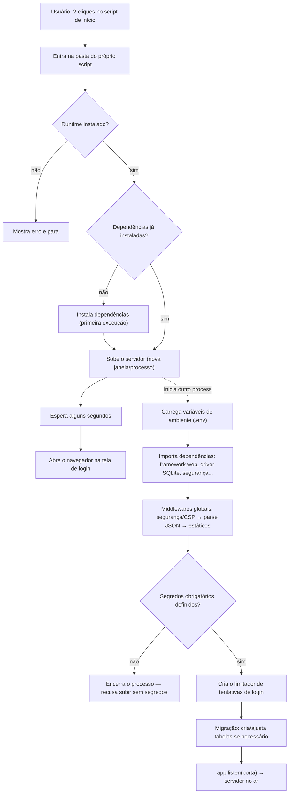
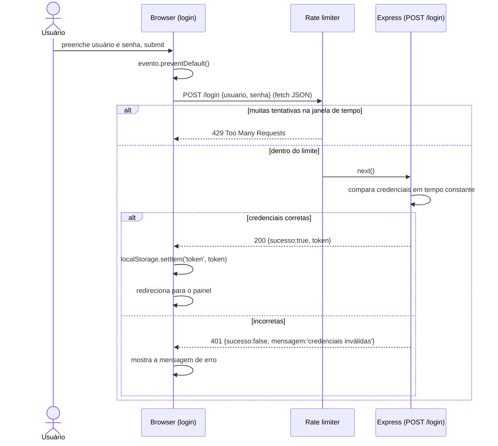
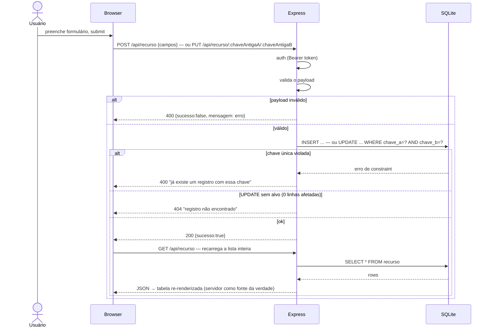
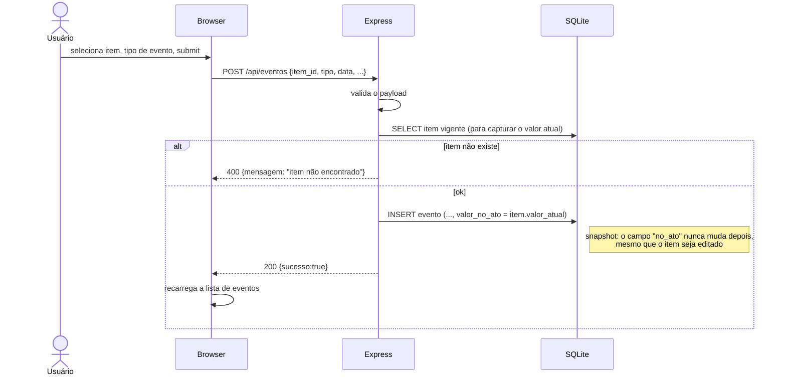
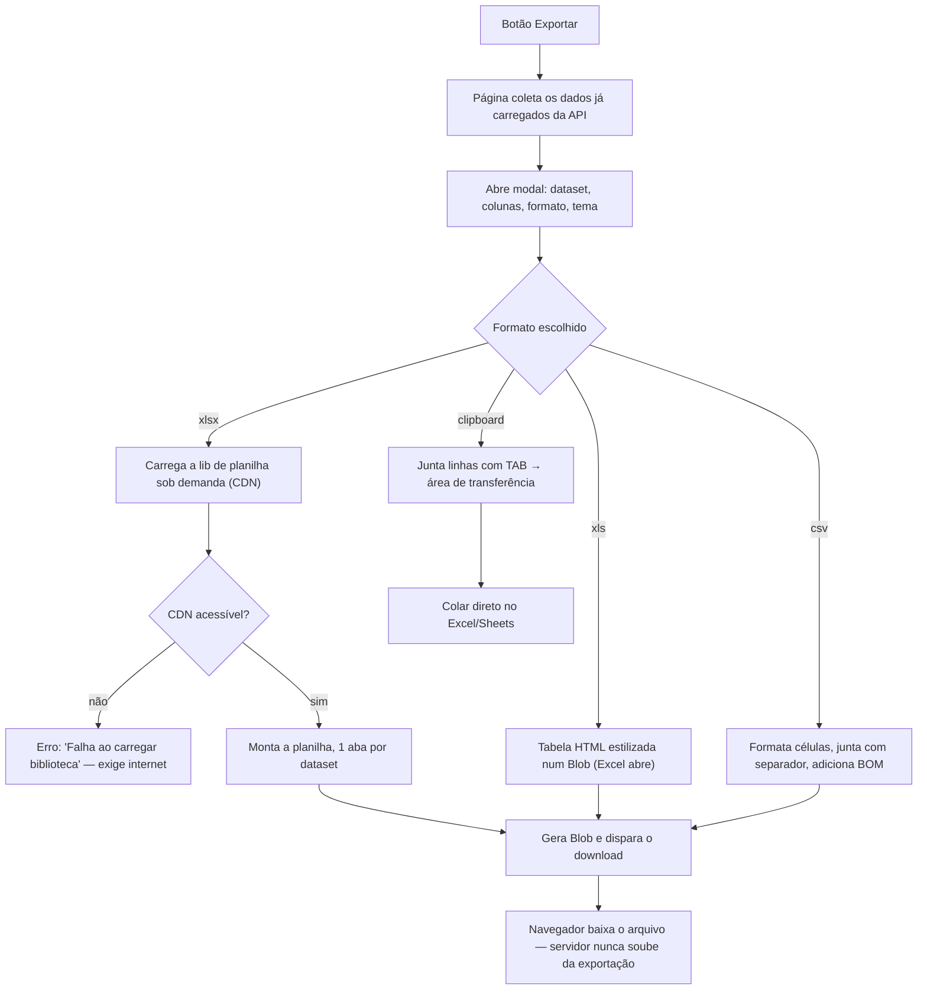
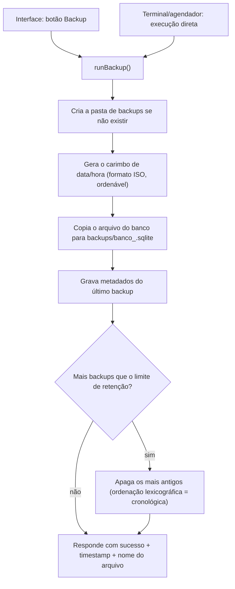

# FLUXOGRAMA — diagramas Mermaid do padrão monólito Node/Express + SQLite

> Material de estudo genérico. Companheiro de `ARQUITETURA.md` e `CONCEITOS.md`.
> Nenhuma referência a um sistema real — rotas e nomes são ilustrativos.
>
> **Como renderizar os diagramas:** no VS Code, instale a extensão *Markdown Preview
> Mermaid Support* e abra a pré-visualização (`Ctrl+Shift+V`); ou cole o bloco em
> https://mermaid.live; no GitHub eles renderizam sozinhos.

---

## (a) Boot — do duplo clique no script ao Express ouvindo

O usuário nunca digita `node server.js`: dá dois cliques num `.bat`/`.sh`. O script
checa o runtime, instala dependências na primeira execução, sobe o servidor (em
outra janela, se for Windows), espera alguns segundos e abre o navegador no login.
Dentro do processo Node: dotenv → middlewares globais → validação dos segredos
(aborta sem eles) → migração de schema → `app.listen`.

---

## (b) Login / autenticação

Sem sessão nem JWT: o "login" valida usuário/senha contra os valores do ambiente
usando comparação em **tempo constante** (evita timing attack) e, se ok, devolve um
**token estático**. O cliente guarda no `localStorage` e passa a enviá-lo como
`Authorization: Bearer <token>` em todas as chamadas. Um rate limiter protege contra
força bruta.

---

## (c) CRUD com chave composta

Quando um recurso não tem `id` único global — a identidade é composta por duas ou
mais colunas (ex.: "matrícula + empresa", "usuário + tenant") — o `PUT`/`DELETE`
carrega a chave **antiga** na URL, e o corpo carrega os campos novos. A violação de
unicidade não precisa ser testada com `SELECT` prévio: o código tenta inserir e
traduz o erro de constraint do banco em mensagem amigável — o banco é a autoridade.

---

## (d) Snapshot histórico — congelar o valor vigente no momento do evento

Padrão de auditoria: ao registrar um evento sobre um item (entrega, movimentação,
transação), o servidor **congela** o valor vigente daquele item na própria linha do
evento. Se o item mudar de valor no futuro, o histórico continua provando o que
valia **na data do evento** — útil sempre que existir requisito documental/legal.

---

## (e) Exportação — tudo no cliente

Exportar **não precisa passar pelo servidor**: um módulo de exportação recebe os
dados que a página já buscou da API, abre um modal de configuração (formato, colunas,
tema) e gera o arquivo **no navegador**. Formatos comuns: `.xlsx` (biblioteca
carregada sob demanda de um CDN), `.xls` (na prática, HTML estilizado que o Excel
aceita), `.csv` (com separador e BOM ajustados pro locale) e cópia direta pra área de
transferência.

---

## (f) Backup — cópia fria com retenção

Um módulo de backup tem tipicamente **duas portas de entrada**: um botão na
interface e a execução direta via linha de comando/agendador (o mesmo arquivo
funciona como lib **e** CLI). O backup é uma **cópia fria** do arquivo do banco.

**Avisos que valem a leitura:** (1) a retenção por ordenação lexicográfica só
funciona **porque** o carimbo usa formato `AAAA-MM-DD` com zero à esquerda — ordem
alfabética vira ordem cronológica; (2) copiar o arquivo do banco com o servidor no ar
é *backup a quente sem lock* — se uma escrita estiver no meio do caminho, a cópia
pode sair inconsistente. O jeito canônico seria usar a API de backup nativa do banco
(ex.: `VACUUM INTO` no SQLite); para um app local mono-usuário, o risco real é baixo,
mas vale saber nomeá-lo.

---

## Índice dos fluxos

| Fluxo | Diagrama |
|---|---|
| Boot (script → Express) | (a) |
| Login / token | (b) |
| CRUD com chave composta | (c) |
| Snapshot histórico | (d) |
| Exportação (cliente) | (e) |
| Backup + retenção | (f) |
